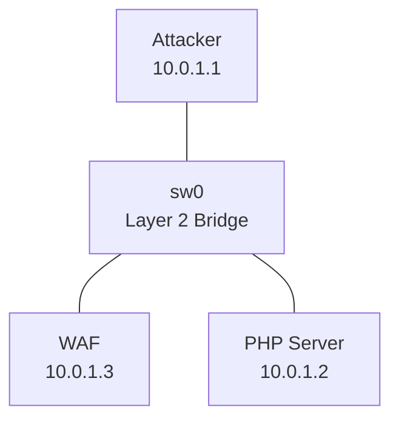

# Layer 7 Web Application Firewall (WAF) Lab

## 1. Overview

This project implements a Layer 7 Web Application Firewall (WAF) using **Containerlab, Docker, NGINX, and ModSecurity**.

The purpose of this lab is to demonstrate how a WAF can inspect HTTP requests and block suspicious traffic before it reaches a backend PHP web application.

The lab focuses on protecting against PHP-to-Shell (php2shell) attack vectors by implementing custom ModSecurity rules.

## 2. Network Topology

The environment consists of four Linux containers connected through an isolated Layer 2 network.

All nodes communicate through the `10.0.1.0/24` subnet.

| Node | IP Address | Description |
|---|---|---|
| attacker | 10.0.1.1/24 | Generates HTTP requests for testing |
| phpserver | 10.0.1.2/24 | Backend PHP web server |
| waf | 10.0.1.3/24 | NGINX reverse proxy with ModSecurity |
| sw0 | N/A | Layer 2 switch using an Alpine Linux bridge |

### Network Diagram



The attacker sends HTTP requests to the WAF. ModSecurity inspects incoming traffic and determines whether requests should be allowed or blocked.

The WAF forwards permitted requests to the backend PHP server.

## 3. Repository Structure

The project is organized as follows:

```text
networking-lab-layer7/
├── README.md
├── lab.clab.yaml
├── images/
│   ├── php/
│   │   └── Dockerfile
│   └── modsec/
│       └── Dockerfile
└── rules/
    └── custom_rules.conf
```

- `lab.clab.yaml`: Defines the Containerlab topology, network interfaces, IP addresses, and container configuration.
- `images/php/Dockerfile`: Defines the custom PHP backend image.
- `images/modsec/Dockerfile`: Defines the custom ModSecurity WAF image.
- `rules/custom_rules.conf`: Contains the custom security rules used by ModSecurity.

## 4. Docker Image Configuration

Two custom Docker images were created for this lab.

### PHP Backend

The PHP server uses the official PHP 8.2.34 Apache image.

### ModSecurity WAF

The WAF uses the OWASP ModSecurity Core Rule Set image with NGINX.


### Building the Images

From the root directory of the repository, build both images:

```bash
docker build -t custom-php:latest ./images/php

docker build -t custom-waf:latest ./images/modsec
```

## 5. ModSecurity Custom Rules

Custom rules were added to `rules/custom_rules.conf` to detect and block suspicious HTTP requests.

The ModSecurity engine and request body inspection are enabled:

```apache
SecRuleEngine On
SecRequestBodyAccess On
```

### Rule 100001: Non-Canonical Multipart Content-Type

```apache
SecRule REQUEST_HEADERS:Content-Type "@rx (?i)^multipart/form-data\s*," \
    "id:100001,\
    phase:1,\
    deny,\
    status:403,\
    log,\
    msg:'Custom Rule: Non-Canonical Multipart Content-Type Blocked'"
```

This rule inspects the HTTP `Content-Type` header and detects suspicious multipart/form-data declarations containing a comma after the media type.

If the condition matches, ModSecurity denies the request and returns HTTP `403 Forbidden`.

### Rule 100002: PHP Session Upload Progress

```apache
SecRule ARGS_NAMES "@streq php_session_upload_progress" \
    "id:100002,\
    phase:2,\
    deny,\
    status:403,\
    log,\
    msg:'Custom Rule: PHP Session Upload Progress Parameter Blocked'"
```

This rule inspects incoming request argument names and detects the `php_session_upload_progress` parameter.

If the parameter is present, ModSecurity blocks the request and returns HTTP `403 Forbidden`.

These rules provide an additional layer of protection against suspicious PHP session upload-related requests.

## 6. Deploying the Lab

After building the Docker images, deploy the Containerlab topology from the repository directory:

```bash
sudo containerlab deploy -t lab.clab.yaml
```

Containerlab creates the four nodes and connects their network interfaces through the `sw0` bridge.

The WAF also exposes its internal port `8080` through host port `80`.

To inspect the running containers:

```bash
docker ps
```

## 7. Testing and Validation

All HTTP tests are performed from the attacker container using `curl`.

### Test 1: Legitimate HTTP Traffic

The first test checks whether a normal HTTP request can reach the backend application through the WAF.

```bash
docker exec -it clab-modsec-l7-lab-attacker \
curl -i -X GET "http://10.0.1.3:8080/index.php?page=home"
```

**Observed result: HTTP 404 Not Found**

The request successfully reached the web application through the WAF, although the specific requested resource returned a `404 Not Found` response.

The web application was ultimately accessible during the lab verification. The instructor reviewed this behavior and accepted the result for the purposes of the assignment.

### Test 2: Non-Canonical Multipart Content-Type

This test sends a POST request containing a suspicious multipart Content-Type header.

```bash
docker exec -it clab-modsec-l7-lab-attacker \
curl -i -X POST "http://10.0.1.3:8080/" \
-H "Content-Type: multipart/form-data,boundary=something" \
-F "test=value"
```

**Expected result: HTTP 403 Forbidden**

ModSecurity detects the non-canonical Content-Type header using custom rule `100001` and blocks the request.

### Test 3: PHP Session Upload Progress Parameter

This test sends a POST request containing the suspicious `php_session_upload_progress` parameter.

```bash
docker exec -it clab-modsec-l7-lab-attacker \
curl -i -X POST "http://10.0.1.3:8080/" \
-F "php_session_upload_progress=exploit_payload"
```

**Expected result: HTTP 403 Forbidden**

ModSecurity detects the parameter using custom rule `100002` and blocks the request.

### Test Results Summary

| Test | Description | Result |
|---|---|---|
| 1 | Legitimate HTTP traffic | HTTP 404 (request reached backend) |
| 2 | Suspicious multipart Content-Type | HTTP 403 |
| 3 | PHP Session Upload Progress | HTTP 403 |

The instructor reviewed the first test and accepted the observed behavior for the purposes of the lab. The two custom security rules were implemented to block the corresponding suspicious requests.

## 8. Cleaning Up

After completing the tests, the lab environment can be removed using:

```bash
sudo containerlab destroy -t lab.clab.yaml
```

This removes the containers and network connections created by Containerlab.

---

## 9. Conclusion

This lab demonstrates the implementation of a Layer 7 Web Application Firewall using NGINX and ModSecurity within a Containerlab network topology.

By creating custom Docker images, configuring an isolated network, and implementing custom ModSecurity rules, it was possible to inspect incoming HTTP requests and block suspicious traffic before it reached the backend PHP application.

The lab provided practical experience with Docker image customization, Containerlab network configuration, reverse proxies, HTTP traffic inspection, and basic web application security.
